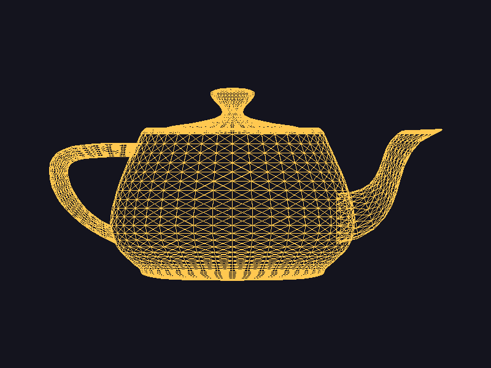

# Proyecto 1 - Parte 1: Dibujando un modelo OBJ

Primera parte del renderer. El programa lee un archivo `.obj` y dibuja todos sus triángulos en la ventana usando las funciones `line` y `triangle` que hicimos en los labs anteriores.



El modelo es la tetera de Utah (3644 vértices y 6320 triángulos), con todas sus caras ya trianguladas.

## Cómo correrlo

Desde la carpeta del proyecto:

```
cargo run --release
```

Por defecto carga `assets/teapot.obj`. Para cargar otro modelo se le pasa la ruta:

```
cargo run --release -- assets/cube.obj
```

Con la ventana abierta, la tecla S guarda una captura en `screenshot.png`. También se puede guardar sin abrir la ventana:

```
cargo run --release -- assets/teapot.obj --screenshot screenshot.png
```

## Archivos

- `src/main.rs`: carga el modelo, lo acomoda en la pantalla y dibuja los triángulos.
- `src/obj.rs`: el cargador de OBJ.
- `src/line.rs`: `line` (Bresenham) y `triangle`.
- `src/framebuffer.rs`: el framebuffer donde se pintan los píxeles.
- `assets/teapot.obj`: el modelo de la captura.
- `assets/cube.obj`: el cubo triangulado de clase, que usé para probar el cargador.

## Qué hace el programa

El cargador lee el archivo línea por línea y solo toma en cuenta las líneas `v` y `f`. Las líneas `v` se convierten en `Vector3` y se guardan en una lista de vértices. En las líneas `f` toma el primer número de cada grupo (de `5/1/1` solo el `5`) y le resta 1, porque OBJ empieza a contar desde 1 y los `Vec` de Rust desde 0. Todo lo demás (`vn`, `vt`, comentarios, etc.) se ignora.

Después se recorren los índices de tres en tres. Con cada grupo se buscan los tres vértices del triángulo y se dibuja con `triangle`, que a su vez llama tres veces a `line`.

Todavía no hay proyección 3D, así que solo se usan `x` y `y` de cada vértice. Para que el modelo quede centrado y de buen tamaño, primero se busca el rango de `x` y `y` del modelo, se escala para que ocupe el 80% de la ventana y se mueve al centro. La `y` se invierte porque en pantalla crece hacia abajo.

Raylib solo se usa para abrir la ventana y mostrar la imagen. No se usan sus funciones para cargar ni dibujar modelos.

## Pruebas

Con el cubo el programa reporta 8 vértices, 36 índices y 12 triángulos. Eso coincide con el archivo, que tiene 8 líneas `v` y 12 líneas `f` (12 × 3 = 36 índices).

## Modelo

La tetera la saqué del repositorio [common-3d-test-models](https://github.com/alecjacobson/common-3d-test-models). El modelo original es de Martin Newell (1975).
